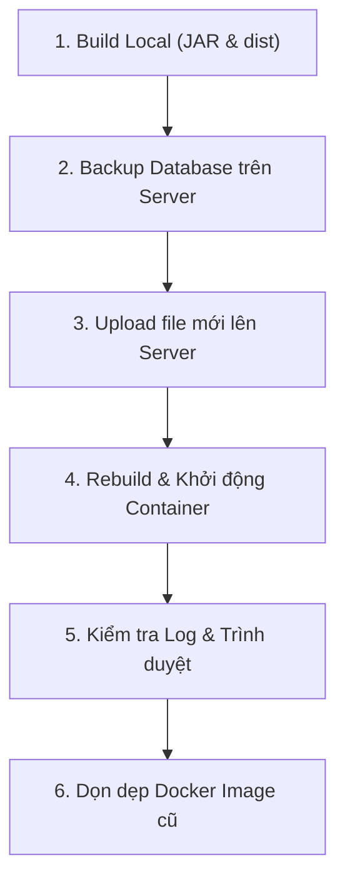

# 🚀 Hướng Dẫn Đóng Gói & Deploy QKShop Lên Server (Set IP Tĩnh Public)

Dự án sử dụng các file Docker có sẵn trong thư mục dự án:
- `docker-compose.yml`: Quản lý 3 dịch vụ **MySQL**, **Backend**, **Frontend**.
- `backend/Dockerfile`: Chạy file `.jar` đã build sẵn từ thư mục `backend/target/`.
- `frontend/Dockerfile` & `frontend/nginx.conf`: Nginx phục vụ giao diện React (`frontend/dist/`) và làm reverse proxy chuyển các request `/api/` sang backend.
- `.env`: File cấu hình IP tĩnh, cổng mạng, mật khẩu database và secret key.

---

## 📑 Mục Lục Hướng Dẫn
1. [BƯỚC 1: Build đóng gói dự án tại máy Local](#-bước-1-build-đóng-gói-dự-án-tại-máy-local)
2. [BƯỚC 2: Cài đặt Docker & Docker Compose](#-bước-2-cài-đặt-docker--docker-compose-gọn--dễ-nhất)
3. [BƯỚC 3: Các file cần đưa lên Server](#-bước-3-các-file-cần-đưa-lên-server)
4. [BƯỚC 4: Cấu hình IP tĩnh để Public cho nhiều người dùng](#-bước-4-cấu-hình-ip-tĩnh-để-public-cho-nhiều-người-dùng)
5. [BƯỚC 5: Khởi chạy trên Server](#-bước-5-khởi-chạy-trên-server)
6. [BƯỚC 6: Import dữ liệu ban đầu (Nếu có file SQL)](#-bước-6-import-dữ-liệu-ban-đầu-nếu-có-file-sql)
7. [BƯỚC 7: Hướng dẫn Dừng & Tắt Hệ Thống (Stop / Shutdown)](#️-bước-7-hướng-dẫn-dừng--tắt-hệ-thống-stop--shutdown)
8. [BƯỚC 8: Quy trình Upload & Cập Nhật Phiên Bản Mới](#-bước-8-quy-trình-upload--cập-nhật-phiên-bản-mới-update-version)
9. [BƯỚC 9: Bảng tra cứu lệnh quản trị & Xử lý sự cố](#-bước-9-bảng-tra-cứu-lệnh-quản-trị--xử-lý-sự-cố)

---

## 📋 BƯỚC 1: Build đóng gói dự án tại máy Local

> Mọi công đoạn build được thực hiện trên máy tính của bạn trước. Không cần cài Java hay Node.js trên server.

### 1. Build Backend (Spring Boot)
Mở terminal tại thư mục dự án (hoặc thư mục `backend/`):
```bash
cd backend
mvn clean package -DskipTests
cd ..
```
*Kết quả:* File `.jar` được tạo tại `backend/target/tonkho-2.0.0.jar`.

### 2. Build Frontend (React / Vite)
Mở terminal tại thư mục `frontend/`:
```bash
cd frontend
npm install
npm run build
cd ..
```
*Kết quả:* Thư mục `frontend/dist/` chứa toàn bộ mã nguồn web đã biên dịch.

---

## 🐳 BƯỚC 2: Cài đặt Docker & Docker Compose (Gọn & Dễ nhất)

> [!NOTE]
> Nếu máy chủ/máy tính của bạn đã cài sẵn Docker, bạn có thể bỏ qua bước này và sang **BƯỚC 3**.

---

### 🐧 Dành cho Linux Server (VPS Ubuntu, Debian, CentOS, Rocky...):
Chỉ cần chạy lệnh script tự động chính thức của Docker (tự cài Docker Engine + Docker Compose):

```bash
# 1. Tải và tự động cài đặt tất cả
curl -fsSL https://get.docker.com -o get-docker.sh && sudo sh get-docker.sh

# 2. Bật dịch vụ Docker khởi động cùng hệ thống
sudo systemctl enable --now docker

# 3. (Tùy chọn) Cho phép dùng lệnh docker không cần gõ 'sudo'
sudo usermod -aG docker $USER && newgrp docker
```

---

### 🪟 Dành cho Windows (PC, Laptop hoặc Windows Server):

**Cách 1: Tải bộ cài chính thức (Dễ nhất)**
1. Tải file cài đặt: [Docker Desktop for Windows (.exe)](https://desktop.docker.com/win/main/amd64/Docker%20Desktop%20Installer.exe)
2. Mở file vừa tải lên, giữ nguyên các tùy chọn mặc định (WSL 2) và nhấn **OK / Next** để cài đặt.
3. Sau khi cài xong, mở ứng dụng **Docker Desktop** để Docker chạy ngầm (thấy biểu tượng chú cá voi ở góc khay hệ thống là thành công).

**Cách 2: Cài bằng 1 lệnh PowerShell (Run as Administrator)**
```powershell
winget install Docker.DockerDesktop
```

---

### 🔍 Kiểm tra sau khi cài đặt (Áp dụng cho cả Windows & Linux):
Mở Terminal (Linux) hoặc PowerShell / CMD (Windows) và gõ:

```bash
docker --version
docker compose version
```
*Khi thấy in ra thông tin phiên bản (ví dụ: `Docker version 27.x.x` và `Docker Compose version v2.x.x`) là xong!*

---

## 📦 BƯỚC 3: Các file cần đưa lên Server

Trên server, bạn chỉ cần một thư mục dự án (ví dụ `/opt/qkshop`) chứa đúng các file sau:

```text
/opt/qkshop/
├── docker-compose.yml
├── .env
├── backend/
│   ├── Dockerfile
│   └── target/
│       └── tonkho-2.0.0.jar
└── frontend/
    ├── Dockerfile
    ├── nginx.conf
    └── dist/
```

> **Mẹo đóng gói nhanh:** 
> Bạn có thể nén các file/thư mục trên thành file `.zip`, upload lên server qua WinSCP / FileZilla / scp, rồi giải nén trên server:
> ```bash
> # Cài unzip nếu server chưa có: sudo apt install -y unzip (Ubuntu) hoặc sudo dnf install -y unzip (CentOS)
> unzip qkshop.zip -d /opt/qkshop
> ```

---

## 🌐 BƯỚC 4: Cấu hình IP tĩnh để Public cho nhiều người dùng

Mở file `.env` (tại thư mục gốc dự án trên server):

```ini
# ==========================================
# Cấu hình IP tĩnh & Cổng truy cập Public
# ==========================================
# 1. Nếu để 0.0.0.0 (khuyên dùng):
#    Hệ thống sẽ lắng nghe trên tất cả các IP của server (IP LAN, IP tĩnh public, VPS...)
BIND_IP=0.0.0.0

# 2. Nếu server có nhiều card mạng và bạn muốn CHỈ ĐỊNH đúng 1 IP tĩnh:
# BIND_IP=192.168.1.100       # (Ví dụ: IP tĩnh trong mạng nội bộ)
# BIND_IP=103.x.x.x           # (Ví dụ: IP tĩnh Public của VPS/Dedicated Server)

# Cổng truy cập web công khai (Mặc định 80 để vào thẳng không cần gõ :port)
HTTP_PORT=80

# ==========================================
# Cấu hình Database & Bảo mật
# ==========================================
DB_PASSWORD=qkshop123@@
DB_NAME=qkshop_tonkho
DB_PORT=3307

JWT_SECRET=357638792F423F4428472B4B6250655368566D597133743677397A2443264629
```

### Lưu ý về kết nối mạng:
1. **Nếu chạy trên VPS / Cloud (AWS, DigitalOcean, Viettel, VNPT...):**
   - Đảm bảo Security Group / Firewall trên trang quản trị đã mở cổng **TCP 80**.
   - Mở firewall trên server Linux (UFW):
     ```bash
     sudo ufw allow 80/tcp
     sudo ufw reload
     ```
   - Mọi người dùng truy cập trực tiếp bằng: `http://<IP_TINH_SERVER>`.

2. **Nếu máy chủ đặt tại mạng nội bộ văn phòng (Local Server):**
   - Đặt IP tĩnh cho máy chủ (Ví dụ `192.168.1.100`).
   - Mọi máy tính, điện thoại cùng kết nối Wifi/mạng LAN có thể vào ngay bằng `http://192.168.1.100`.
   - Nếu muốn người từ xa (ngoài Internet) truy cập được: Vào Modem/Router mạng của bạn cấu hình **Port Forwarding / Virtual Server**: chuyển cổng ngoài `80` về IP máy chủ `192.168.1.100:80`.

---

## 🚀 BƯỚC 5: Khởi chạy trên Server

Tại thư mục chứa dự án trên server (`/opt/qkshop`), chạy:

```bash
# 1. Build image và khởi động ngầm các dịch vụ
docker compose up -d --build

# 2. Kiểm tra trạng thái các container (phải hiện State là Up)
docker compose ps

# 3. Xem log hoạt động nếu cần
docker compose logs -f
```

Hệ thống đã hoạt động:
- Giao diện Web: `http://<IP_TINH>` (cổng 80)
- Tài khoản quản trị mặc định: `admin` / `admin123`

---

## 🗄️ BƯỚC 6: Import dữ liệu ban đầu (Nếu có file SQL)

Nếu bạn có sẵn file backup SQL (ví dụ: `backup_qkshop_tonkho_2026_10_12_chuan.sql`), upload file này lên server rồi chạy lệnh:

```bash
docker exec -i qkshop_db mysql -uroot -pqkshop123@@ qkshop_tonkho < backup_qkshop_tonkho_2026_10_12_chuan.sql
```
*(Thay `qkshop123@@` bằng mật khẩu bạn đã đặt trong `.env`)*

---

## ⏹️ BƯỚC 7: Hướng dẫn Dừng & Tắt Hệ Thống (Stop / Shutdown)

Tùy vào nhu cầu (tạm dừng bảo trì nhanh hay tắt hẳn hệ thống), bạn chọn lệnh phù hợp dưới đây:

### 1. Dừng tạm thời (`docker compose stop`)
*Dùng khi: Cần tạm dừng server để bảo trì, sửa chữa phần cứng hoặc tiết kiệm tài nguyên.*
```bash
# Dừng toàn bộ 3 dịch vụ (MySQL, Backend, Frontend)
docker compose stop
```
- **Đặc điểm:** Toàn bộ tiến trình dừng chạy và giải phóng CPU/RAM, nhưng các container và mạng nội bộ vẫn giữ nguyên.
- **Khởi động lại cực nhanh:** Khi muốn bật lại, chỉ cần gõ:
  ```bash
  docker compose start
  ```
  *(Hệ thống sẽ chạy lại ngay trong 1-2 giây mà không cần tạo mới container).*

### 2. Tắt hoàn toàn (`docker compose down`)
*Dùng khi: Muốn tắt sạch hệ thống, làm mới hoàn toàn cấu hình mạng hoặc chuẩn bị khởi động lại từ đầu.*
```bash
# Dừng và gỡ bỏ toàn bộ container
docker compose down
```
- **Đặc điểm:** Các container và network ảo sẽ được gỡ bỏ sạch sẽ. 
- **An toàn dữ liệu:** Dữ liệu trong Database MySQL được lưu trong ổ đĩa cứng ảo (`volume: mysql_data`) nên **hoàn toàn an toàn, không bị mất**.
- **Khởi chạy lại sau khi down:**
  ```bash
  docker compose up -d
  ```

### 3. Dừng riêng từng dịch vụ độc lập
Nếu bạn chỉ muốn dừng một thành phần mà không muốn ảnh hưởng đến các thành phần còn lại:
```bash
# Dừng riêng Backend:
docker compose stop backend

# Bật lại Backend:
docker compose start backend

# Dừng riêng Frontend:
docker compose stop frontend

# Bật lại Frontend:
docker compose start frontend
```

### 4. Khởi động lại nhanh (Restart)
Khi muốn khởi động lại dịch vụ ngay lập tức:
```bash
# Khởi động lại toàn bộ:
docker compose restart

# Khởi động lại riêng Backend (ví dụ khi cần reload cấu hình):
docker compose restart backend
```

> [!CAUTION]
> **CẢNH BÁO QUAN TRỌNG VỀ AN TOÀN DỮ LIỆU DATABASE:**
> - **TUYỆT ĐỐI KHÔNG DÙNG:** `docker compose down -v`
> - Cờ `-v` (volumes) sẽ **XÓA VĨNH VIỄN** volume `mysql_data` chứa toàn bộ cơ sở dữ liệu kho hàng của bạn. Chỉ dùng cờ `-v` khi bạn thực sự muốn reset trắng tinh toàn bộ dữ liệu dự án!

---

## 🔄 BƯỚC 8: Quy Trình Upload & Cập Nhật Phiên Bản Mới (Update Version)

Khi bạn đã sửa code, fix bug hoặc thêm tính năng mới ở máy Local và muốn triển khai lên Server đang chạy, hãy tuân theo quy trình chuẩn 6 bước an toàn sau:



---

### Bước 8.1: Đóng gói bản cập nhật tại máy Local
Mở Terminal tại máy tính phát triển của bạn:

**1. Nếu có thay đổi Backend (Java / Spring Boot):**
```bash
cd backend
mvn clean package -DskipTests
cd ..
```
*Kết quả:* File `.jar` mới được tạo tại thư mục `backend/target/tonkho-2.0.0.jar`.

**2. Nếu có thay đổi Frontend (React / Vite):**
```bash
cd frontend
npm run build
cd ..
```
*Kết quả:* Toàn bộ code giao diện web mới nhất được xuất ra thư mục `frontend/dist/`.

---

### Bước 8.2: Sao lưu Database trên Server trước khi cập nhật
> [!TIP]
> Luôn tạo 1 bản snapshot cơ sở dữ liệu trước mỗi lần nâng cấp để phòng trường hợp code mới có thay đổi cấu trúc bảng.

Đăng nhập SSH vào Server, chuyển vào thư mục `/opt/qkshop` và chạy:
```bash
# Tạo file backup kèm ngày giờ tự động
docker exec qkshop_db mysqldump -uroot -pqkshop123@@ qkshop_tonkho > backup_truoc_khi_update_$(date +%Y%m%d_%H%M%S).sql
```
*(Thay `qkshop123@@` bằng mật khẩu CSDL trong file `.env` của bạn).*

---

### Bước 8.3: Upload file cập nhật lên Server

Bạn có thể chọn 1 trong 2 cách tải file lên Server:

#### 🔹 Cách 1: Sử dụng phần mềm WinSCP hoặc FileZilla (Trực quan, dễ dùng nhất)
1. Mở **WinSCP** hoặc **FileZilla**, kết nối giao thức **SFTP** đến IP Server:
   - **Host:** IP Public của Server
   - **Port:** 22
   - **Username / Password:** Tài khoản quản trị server (root hoặc ubuntu)
2. Điều hướng cửa sổ bên phải (Server) đến thư mục `/opt/qkshop/`.
3. Kéo thả file từ máy tính sang server:
   - **Cập nhật Backend:** Kéo file `.jar` từ máy local vào `/opt/qkshop/backend/target/` (Chọn **Overwrite/Ghi đè**).
   - **Cập nhật Frontend:** Kéo toàn bộ thư mục `dist/` vào `/opt/qkshop/frontend/` (Chọn **Ghi đè tất cả các file**).
   - **Cập nhật cấu hình (nếu có):** Nếu có sửa `.env` hoặc `docker-compose.yml`, kéo thả đè lên `/opt/qkshop/`.

#### 🔹 Cách 2: Dùng lệnh SCP trực tiếp từ máy tính (Nhanh cho Terminal)
Mở PowerShell (Windows) hoặc Terminal (macOS/Linux) ngay tại thư mục dự án trên máy tính:

```bash
# 1. Upload file JAR mới lên Server:
scp backend/target/tonkho-2.0.0.jar root@<IP_SERVER>:/opt/qkshop/backend/target/

# 2. Upload thư mục Frontend dist mới:
# (Mẹo: Nên nén dist thành dist.zip để upload nhanh hơn hàng trăm file nhỏ)
# Tại máy local:
tar -czvf dist.tar.gz -C frontend/dist .
scp dist.tar.gz root@<IP_SERVER>:/opt/qkshop/frontend/

# Trên server, giải nén ghi đè:
# cd /opt/qkshop/frontend && tar -xzvf dist.tar.gz -C dist/ && rm dist.tar.gz
```

---

### Bước 8.4: Rebuild & Kích hoạt phiên bản mới trên Server

Đăng nhập vào server tại thư mục `/opt/qkshop`, chọn phương án cập nhật tương ứng:

#### 🌟 Phương án A: Cập nhật Hotfix riêng lẻ (Khuyên dùng - Không ảnh hưởng Database)
Nếu bạn chỉ cập nhật Frontend hoặc Backend, dùng cờ `--no-deps` để Docker chỉ cập nhật đúng dịch vụ đó, MySQL vẫn chạy liên tục không bị gián đoạn:

- **Chỉ cập nhật Backend:**
  ```bash
  docker compose up -d --no-deps --build backend
  ```
- **Chỉ cập nhật Frontend:**
  ```bash
  docker compose up -d --no-deps --build frontend
  ```

#### 🌟 Phương án B: Cập nhật toàn diện (Cả Backend và Frontend)
```bash
docker compose up -d --build
```
*Docker Compose sẽ phát hiện file mới, tiến hành build lại image tương ứng và thay thế container cũ bằng container mới trong vòng vài giây mà không làm mất dữ liệu Database.*

---

### Bước 8.5: Kiểm tra và xác nhận sau cập nhật

1. **Kiểm tra trạng thái container:**
   ```bash
   docker compose ps
   ```
   *Các container phải ở trạng thái `Up` hoặc `Up (healthy)`.*

2. **Theo dõi log khởi động Backend để đảm bảo không có lỗi Java:**
   ```bash
   docker compose logs -f --tail=100 backend
   ```
   *(Nhìn thấy dòng chữ `Started TonkhoApplication in ... seconds` là thành công. Bấm `Ctrl + C` để thoát màn hình xem log).*

3. **Kiểm tra trên trình duyệt:**
   - Mở trình duyệt truy cập: `http://<IP_SERVER>`
   - Nhấn tổ hợp phím **`Ctrl + Shift + R`** (hoặc `Cmd + Shift + R` trên Mac) để xóa sạch cache trình duyệt cũ và nạp ngay giao diện của phiên bản mới.

---

### Bước 8.6: Dọn dẹp Docker Image cũ (Giải phóng ổ cứng)
Sau nhiều lần rebuild cập nhật phiên bản, Docker sẽ lưu lại các image cũ không còn sử dụng (dangling images `<none>`), làm đầy bộ nhớ đĩa server:

```bash
# Dọn dẹp an toàn các image cũ không dùng
docker image prune -f
```

---

### 🚨 Kế hoạch Rollback (Khôi phục khẩn cấp nếu bản mới gặp sự cố)
Nếu sau khi cập nhật phiên bản mới phát hiện lỗi nghiêm trọng, bạn có thể hoàn tác ngay lập tức:

1. **Khôi phục Code:** Copy lại file `.jar` hoặc thư mục `dist` của phiên bản ổn định trước đó vào thư mục dự án và chạy lại:
   ```bash
   docker compose up -d --build
   ```
2. **Khôi phục Database (Nếu cần):**
   ```bash
   docker exec -i qkshop_db mysql -uroot -pqkshop123@@ qkshop_tonkho < backup_truoc_khi_update_xxxxxx.sql
   ```

---

## 🛠️ BƯỚC 9: Bảng Tra Cứu Lệnh Quản Trị & Xử Lý Sự Cố

### 📋 Bảng tra cứu lệnh thông dụng:

| Thao tác | Lệnh thực hiện |
| :--- | :--- |
| **Xem trạng thái tất cả dịch vụ** | `docker compose ps` |
| **Xem log trực tiếp toàn hệ thống** | `docker compose logs -f` |
| **Xem 100 dòng log gần nhất của Backend** | `docker compose logs -f --tail=100 backend` |
| **Xem log của Frontend (Nginx)** | `docker compose logs -f --tail=100 frontend` |
| **Khởi động lại toàn bộ** | `docker compose restart` |
| **Dừng tạm thời hệ thống** | `docker compose stop` |
| **Bật lại hệ thống sau khi stop** | `docker compose start` |
| **Tắt và dỡ bỏ container** | `docker compose down` |
| **Build lại và bật ngầm** | `docker compose up -d --build` |
| **Kiểm tra RAM & CPU của các container** | `docker stats` |
| **Truy cập vào shell của Backend** | `docker exec -it qkshop_backend sh` |
| **Truy cập vào MySQL CLI** | `docker exec -it qkshop_db mysql -uroot -p` |
| **Dọn rác Docker (Images & Containers cũ)** | `docker system prune -f` |

---

### ❓ Xử lý một số sự cố thường gặp:

1. **Lỗi `502 Bad Gateway` khi vừa vào web:**
   - *Nguyên nhân:* Backend Spring Boot đang trong quá trình khởi động (mất khoảng 15-30 giây) nên Nginx chưa kết nối được.
   - *Cách xử lý:* Gõ `docker compose logs -f backend`, đợi dòng `Started TonkhoApplication` xuất hiện rồi F5 lại trình duyệt.

2. **Giao diện web vẫn hiển thị bản cũ sau khi update:**
   - *Nguyên nhân:* Trình duyệt (Chrome, Cốc Cốc, Edge) lưu cache các file JS/CSS cũ.
   - *Cách xử lý:* Nhấn `Ctrl + F5` hoặc `Ctrl + Shift + R` trên trình duyệt.

3. **Cổng 80 bị chiếm (Port is already allocated):**
   - *Nguyên nhân:* Có dịch vụ khác (Apache, IIS hoặc Nginx cài trực tiếp) đang chạy trên cổng 80.
   - *Cách xử lý:* Tắt dịch vụ đó (`sudo systemctl stop nginx` / `sudo systemctl stop apache2`) hoặc đổi `HTTP_PORT=8088` trong file `.env`.

