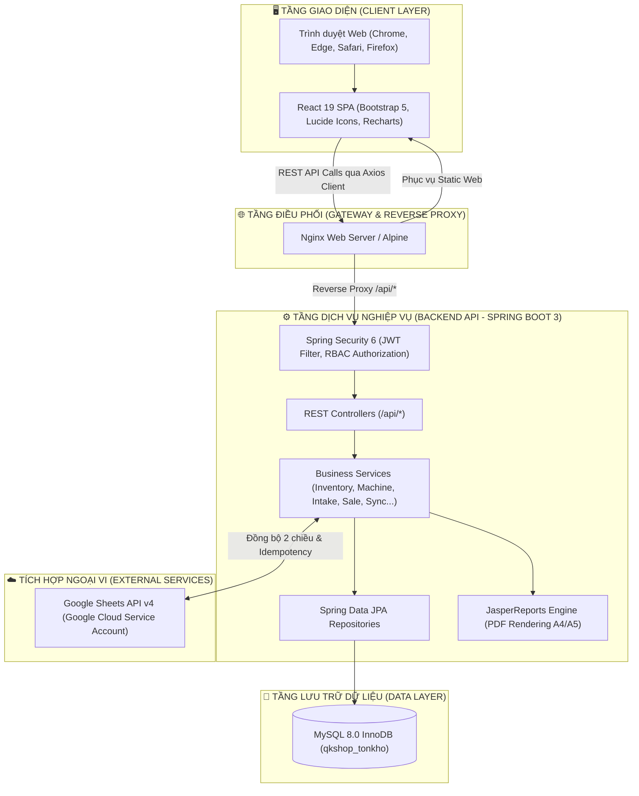
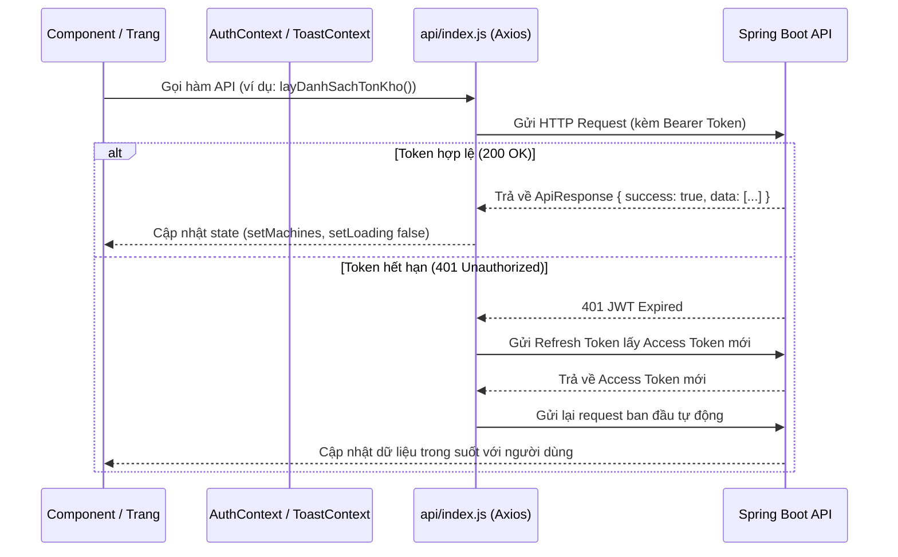

# 🏗️ TÀI LIỆU THIẾT KẾ KIẾN TRÚC HỆ THỐNG
## QKSHOP WAREHOUSE MANAGEMENT SYSTEM (WMS)

---

## 1. TỔNG QUAN KIẾN TRÚC (HIGH-LEVEL ARCHITECTURE)

Hệ thống **QKShop WMS** được xây dựng theo mô hình kiến trúc phân tầng hiện đại (**N-Tier Decoupled Architecture**) với sự phân tách triệt để giữa tầng giao diện người dùng (Frontend SPA) và tầng xử lý nghiệp vụ trung tâm (Backend Microservices/RESTful API), liên kết với hệ thống lưu trữ dữ liệu quan hệ MySQL và hệ thống ngoài Google Cloud.



---

## 2. THIẾT KẾ KIẾN TRÚC BACKEND (SPRING BOOT 3.3 / JAVA 21)

### 2.1. Phân Tầng Mã Nguồn (Package Architecture)
Các package nằm thống nhất dưới tiền tố `com.qkshop.tonkho`:

| Package | Trách nhiệm chính |
|:---|:---|
| `*.auth` | Xử lý xác thực người dùng, tạo & xác minh JWT (Access/Refresh Token), Filter kiểm tra header `Authorization`. |
| `*.user` | Quản lý danh sách tài khoản, hồ sơ cá nhân, phân quyền RBAC và mã quyền `AppPermission`. |
| `*.inventory` | Quản lý kho máy đang hoạt động (`ActiveInventory`), lịch sử vòng đời đã đóng (`ClosedCycle`) và snapshot hàng ngày. |
| `*.machine` | Quản lý định danh duy nhất số máy (`SerialRegistry`), nhập máy đơn lẻ hoặc hàng loạt (`BulkMachineImport`). |
| `*.catalog` | Danh mục dòng máy, thương hiệu (`Brand`), cấu hình CPU, GPU, RAM, SSD (`VariantV2`, `Platform`). |
| `*.intake` | Tiếp nhận máy mới, tạo vòng đời, tự động gán trạng thái kiểm định ban đầu. |
| `*.inspection` | Quy trình kiểm định chất lượng máy (QC), ghi nhận biên bản kiểm tra, chuyển trạng thái máy từ `NEEDS_INSPECTION` sang `READY`. |
| `*.accessory` | Quản lý kho linh kiện, phụ kiện theo mã SKU, lịch sử xuất bán và trừ tồn kho tự động. |
| `*.sale` | Quản lý giao dịch bán máy, ghi nhận doanh thu, khách hàng, phương thức thanh toán và tự động đóng vòng đời tồn kho. |
| `*.sync` | Lập lịch (Scheduler) đồng bộ hai chiều với Google Sheets, đối soát lệch kho (`ReconciliationService`), bảng kê lệnh (`CommandLedger`). |
| `*.notification` | Trung tâm phát thông báo thời gian thực (`AppNotification`), đánh dấu đã đọc, phân loại cảnh báo. |
| `*.pricelist` | Tích hợp JasperReports kết xuất file PDF bảng giá sản phẩm theo mẫu biểu A4 và A5 chuẩn in ấn. |
| `*.log` | Ghi nhận nhật ký người dùng (`ActivityLog`) và nhật ký sự kiện hệ thống (`EventLog`). |
| `*.system` | Cấu hình tham số hệ thống động (`SystemConfig`), bảo trì làm sạch dữ liệu (`DataMaintenanceService`). |
| `*.core` | Đối tượng dùng chung (`ApiResponse<T>`), Enums trạng thái (`CycleState`, `ApprovalStatus`, `CloseType`). |
| `*.exception` | Bắt và chuẩn hóa ngoại lệ toàn cục (`GlobalExceptionHandler`), thông báo lỗi tiếng Việt thân thiện. |

### 2.2. Cơ Chế Bảo Mật & Phân Quyền (Security & RBAC)
1. **Stateless Authentication**: Server không lưu session trong bộ nhớ. Mọi request đều kèm Access Token trong header:
   ```http
   Authorization: Bearer <jwt_access_token>
   ```
2. **Cơ chế Token Kép (Dual-Token Mechanism)**:
   - **Access Token**: Có hiệu lực 24 giờ, chứa thông tin `userId`, `username`, `role` và mảng `permissions`.
   - **Refresh Token**: Có hiệu lực 7 ngày, dùng để cấp mới Access Token mà không bắt người dùng đăng nhập lại.
3. **Phân quyền tại Service/Controller**: Sử dụng annotation chuẩn `@PreAuthorize`:
   ```java
   @PreAuthorize("hasAuthority('MANAGE_MACHINES') or hasRole('ADMIN')")
   ```

---

## 3. THIẾT KẾ KIẾN TRÚC FRONTEND (REACT 19 / VITE 6)

### 3.1. Luồng Dữ Liệu & Quản Lý Trạng Thái (State Flow)


### 3.2. Cấu Trúc Thành Phần Giao Diện
- **Routing & Lazy Loading**: 100% các trang nghiệp vụ lớn (`TrangBangGia`, `TrangThongKe`, `TrangDoiSoat`...) được phân tách mã nguồn qua `React.lazy()` và `Suspense` giúp ứng dụng tải trang ban đầu chỉ dưới **1 giây**.
- **Tập Trung Hóa API**: Mọi lời gọi HTTP đều thông qua `src/api/index.js` và `src/api/axiosClient.js`, tuyệt đối không phân tán code gọi mạng trong từng component nhỏ lẻ.
- **Tiêu chuẩn Định dạng**: Mọi dữ liệu số tiền đều đi qua tiện ích `dinhDangTien()` trong `src/utils/dinh_dang.js` hiển thị đơn vị `₫` chuẩn Việt Nam.

---

## 4. CHIẾN LƯỢC BẢO TOÀN DỮ LIỆU & TRANSACTION

- Mọi thao tác ghi nhận nhập máy, bán máy, xuất phụ kiện đều được bọc trong `@Transactional(rollbackFor = Exception.class)`. Nếu có bất kỳ lỗi nào xảy ra ở bất kỳ bước nào, toàn bộ giao dịch sẽ tự động hoàn tác (Rollback) 100%, chống hiện tượng rác dữ liệu hoặc sai lệch số tồn kho.
- Khóa duy nhất (Unique Constraints) trên cơ sở dữ liệu:
  - Bảng `serial_registry`: Cặp (`serial`, `company_code`) là duy nhất.
  - Bảng `accessories`: Khóa `sku` là duy nhất.
  - Bảng `users`: Khóa `username` là duy nhất.
