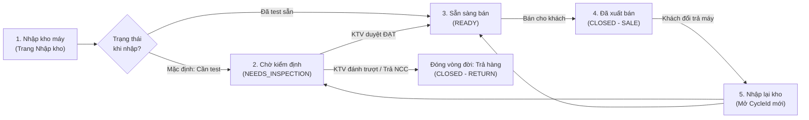
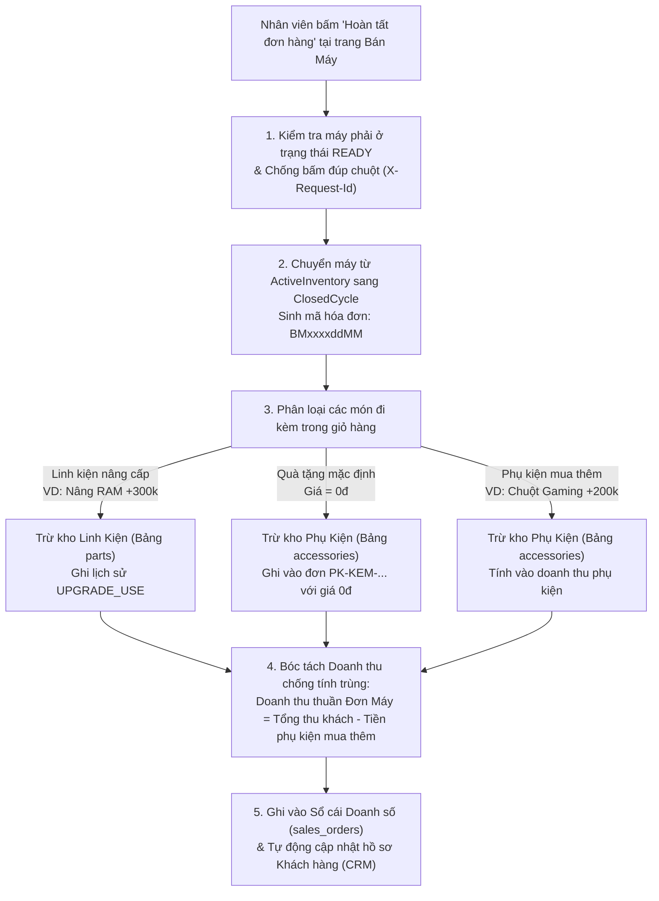

# 📘 TÀI LIỆU TỔNG HỢP HỆ THỐNG QUẢN LÝ KHO QKSHOP (V2)
## Giải Thích Toàn Bộ Luồng Xử Lý Nghiệp Vụ, Hướng Dẫn Sử Dụng & Vận Hành Hệ Thống

> **Giới thiệu:**  
> Đây là tài liệu tổng hợp **duy nhất và đầy đủ nhất** của hệ thống **QKShop Warehouse Management System (V2)**. Tài liệu được trình bày bằng ngôn ngữ thực tế, dễ hiểu, giúp **Chủ cửa hàng, Quản lý, Nhân viên bán hàng, Nhân viên kho, Kỹ thuật viên** và **Quản trị viên** nắm vững toàn bộ luồng hoạt động và cách sử dụng phần mềm từ A đến Z.

---

## 📑 MỤC LỤC TỔNG HỢP

- **PHẦN I: BỨC TRANH TỔNG THỂ — HỆ THỐNG HOẠT ĐỘNG NHƯ THẾ NÀO?**
  - 1.1. Ba kho hàng độc lập trong hệ thống (Kho Máy, Kho Phụ kiện, Kho Linh kiện)
  - 1.2. Nguyên tắc "Một Nguồn Sự Thật Duy Nhất" (SSOT)
  - 1.3. Quy tắc tự động sinh Mã Hóa Đơn (`BM`, `PK`, `SC`) & Mã SKU
  - 1.4. Cơ chế Phân quyền Nhân sự (3 Vai trò & 27 Quyền chi tiết)
- **PHẦN II: GIẢI THÍCH CHI TIẾT 8 LUỒNG XỬ LÝ NGHIỆP VỤ TRONG HỆ THỐNG**
  - Luồng 1: Vòng đời của 1 chiếc máy tính (Từ lúc nhập kho đến lúc xuất bán)
  - Luồng 2: Bán máy tại quầy (POS) — Bóc tách doanh thu, trừ quà tặng & nâng cấp
  - Luồng 3: Đơn Ship COD — Giao hàng, kích hoạt bảo hành khi nhận & hoàn đơn ship
  - Luồng 4: Quản lý & Bán lẻ Phụ kiện (`PK-...`)
  - Luồng 5: Quản lý Linh kiện (`LK-...`) & Tiếp nhận Dịch vụ Sửa chữa (`SC...`)
  - Luồng 6: Tra cứu Bảo hành "3 trong 1" & Xử lý Đổi trả / Hoàn hàng
  - Luồng 7: Quản lý Khách hàng (CRM) & Chăm sóc máy hết hạn bảo hành
  - Luồng 8: Đồng bộ & Đối soát dữ liệu 2 chiều với Google Sheets
- **PHẦN III: HƯỚNG DẪN SỬ DỤNG CHI TIẾT 24 MÀN HÌNH (THEO 6 NHÓM MENU)**
  - Nhóm 1: Tổng quan & Báo cáo (*Bàn điều hành, Báo cáo doanh số, Thống kê phân tích*)
  - Nhóm 2: Bán hàng & Dịch vụ (*Bán máy POS, Bán phụ kiện lẻ, Đơn ship, Sửa chữa, Bảng giá PDF*)
  - Nhóm 3: Kho máy & Kiểm định (*Tồn kho máy, Quản lý mã máy, Nhập kho máy, Kiểm định QC*)
  - Nhóm 4: Linh kiện & Phụ kiện (*Nhập/Tồn/Lịch sử phụ kiện, Nhập/Tồn linh kiện*)
  - Nhóm 5: Bảo hành & CRM (*Tra cứu bảo hành 3 trong 1, Khách hàng CRM, Máy hết hạn bảo hành*)
  - Nhóm 6: Hệ thống & Đối soát (*Đối soát Google Sheet, Nhật ký hoạt động, Cấu hình & Phân quyền*)
- **PHẦN IV: HƯỚNG DẪN TRIỂN KHAI, CẬP NHẬT & SAO LƯU TRÊN SERVER / VPS**
- **PHẦN V: CÂU HỎI THƯỜNG GẶP (FAQ) & XỬ LÝ TÌNH HUỐNG THỰC TẾ**

---

# PHẦN I: BỨC TRANH TỔNG THỂ — HỆ THỐNG HOẠT ĐỘNG NHƯ THẾ NÀO?

## 1.1. Ba kho hàng độc lập trong hệ thống

Để không bao giờ xảy ra nhầm lẫn giữa máy bán chính, quà tặng kèm và linh kiện kỹ thuật, hệ thống chia hàng hóa thành **3 kho riêng biệt**:

| Tên Kho | Quản lý theo | Định dạng mã chuẩn | Mục đích sử dụng thực tế |
|:---|:---|:---|:---|
| **1. Kho Máy Tính** | Từng chiếc theo **Số Serial / Service Tag** | VD: `SN-DELL-8899` | Quản lý từng chiếc laptop/PC cụ thể. Mỗi máy tại một thời điểm chỉ có 1 trạng thái duy nhất. |
| **2. Kho Phụ Kiện** | Số lượng theo **Mã SKU Phụ kiện** | `PK-<LOẠI>-<4 SỐ>`<br>*(VD: `PK-CHUOT-0001`)* | Hàng rời: Chuột, Balo, Túi chống sốc, Lót chuột, Hub... Dùng để **tặng kèm khi bán máy (0đ)** hoặc **bán lẻ**. |
| **3. Kho Linh Kiện** | Số lượng theo **Mã SKU Linh kiện** | `LK-<LOẠI>-<4 SỐ>`<br>*(VD: `LK-RAM-0001`)* | Phần cứng: RAM, SSD, HDD, Pin, Màn hình, Phím, Sạc, Main... Dùng để **nâng cấp máy khi bán** hoặc **thay thế sửa chữa**. |

---

## 1.2. Nguyên tắc "Một Nguồn Sự Thật Duy Nhất" (SSOT)

Hệ thống được thiết kế để **số liệu giữa các màn hình luôn khớp nhau 100%**:

| Đối tượng dữ liệu | Bảng lưu trữ chuẩn (SSOT) | Cách hệ thống đảm bảo không bao giờ lệch dữ liệu |
|:---|:---|:---|
| **Danh tính Serial máy** | `serial_registry` | Mỗi số Serial là duy nhất, luôn trỏ tới trạng thái và vòng đời hiện tại của máy. |
| **Máy đang trong kho** | `active_inventory` | Chỉ chứa các máy đang ở trong cửa hàng (`NEEDS_INSPECTION` hoặc `READY`). |
| **Máy đã bán / đã trả** | `closed_cycles` | Khi máy bán xong, máy được chuyển hẳn từ `active_inventory` sang `closed_cycles` (không thể bán trùng 1 máy 2 lần). |
| **Sổ cái Doanh thu tổng** | `sales_orders` | Mọi đơn **Bán máy (`MACHINE`)**, **Phụ kiện (`ACCESSORY`)** và **Sửa chữa (`REPAIR`)** đều tự động đồng bộ về đây để lên Báo cáo doanh số. |
| **Hồ sơ Khách hàng CRM** | `crm_customers` | Tự động gom nhóm mọi đơn hàng của cùng 1 khách theo Số điện thoại đã chuẩn hóa. |

---

## 1.3. Quy tắc tự động sinh Mã Hóa Đơn & Mã SKU

Khi nhân viên bấm tạo đơn, hệ thống tự động sinh **Mã hóa đơn 10 ký tự** theo công thức:
> **`[Tiền tố 2 chữ cái] + [Số thứ tự đơn trong tháng (4 chữ số)] + [NgàyTháng ddMM (4 chữ số)]`**

- **Đơn Bán Máy (`BM`):** Ví dụ `BM00010611` $\rightarrow$ Đơn bán máy thứ `0001` trong tháng 11, lập ngày `06/11`.
- **Đơn Bán Phụ Kiện (`PK`):** Ví dụ `PK00120611` $\rightarrow$ Đơn bán lẻ phụ kiện thứ `0012` trong tháng 11, lập ngày `06/11`.
- **Phiếu Sửa Chữa (`SC`):** Ví dụ `SC00050611` $\rightarrow$ Phiếu dịch vụ sửa chữa thứ `0005` trong tháng 11, lập ngày `06/11`.
- **Đơn Phụ Kiện Đi Kèm Máy (`PK-KEM-...`):** Tự động sinh ngầm khi khách mua máy có kèm quà tặng hoặc mua thêm phụ kiện.

---

## 1.4. Cơ chế Phân quyền Nhân sự (3 Vai trò & 27 Quyền chi tiết)

- **3 Vai trò gốc (`UserRole`):**
  1. **`ADMIN` (Quản trị viên):** Có toàn bộ 27/27 quyền trên hệ thống.
  2. **`MANAGER` (Quản lý):** Có đầy đủ quyền vận hành, xem báo cáo, sửa đơn, đối soát (chỉ giới hạn quyền xóa vĩnh viễn máy `MACHINE_DELETE` và cấu hình hệ thống sâu `SYSTEM_MANAGE`).
  3. **`STAFF` (Nhân viên):** Có các quyền tác nghiệp hàng ngày (Bán hàng, Tra cứu kho, Kiểm định, Sửa chữa, Bảo hành).
- **Cấp quyền linh hoạt theo từng cá nhân:** Quản trị viên có thể bật/tắt riêng từng mã quyền trong **27 mã quyền** cho bất kỳ tài khoản nào tại mục *Cấu hình & Phân quyền (`/he-thong`)*.

---

# PHẦN II: GIẢI THÍCH CHI TIẾT 8 LUỒNG XỬ LÝ NGHIỆP VỤ TRONG HỆ THỐNG

---

## Luồng 1: Vòng đời của 1 chiếc máy tính (Từ lúc nhập kho đến lúc xuất bán)

Mỗi lần một chiếc máy tính vào kho cho đến khi xuất ra khỏi kho được gọi là **1 Vòng đời (`Cycle`)**, có mã định danh `CYC-...`.



### Chi tiết xử lý bên dưới hệ thống:
1. **Bước Nhập Kho (`/nhap-may`):**
   - Hỗ trợ 3 phương thức: **Nhập đơn lẻ 1 máy**, **Nhập theo lô (nhiều Serial chung cấu hình)**, hoặc **Nhập từ file Excel (có bước Xem trước - Preview)**.
   - Hệ thống tự động chuẩn hóa số Serial (viết hoa, cắt khoảng trắng thừa) và kiểm tra chống trùng: nếu Serial đang nằm trong `active_inventory` thì chặn ngay lập tức.
   - Nếu nhập ở trạng thái **`NEEDS_INSPECTION` (Cần kiểm định)**, hệ thống tự động khởi tạo 1 phiếu chờ test bên màn hình *Kiểm định chất lượng (`/kiem-tra`)*.
2. **Bước Kiểm Định Chất Lượng QC (`/kiem-tra`):**
   - Kỹ thuật viên bấm **"Bắt đầu"**, kiểm tra phần cứng (Màn hình, Phím, Pin, Loa, Cam, Cổng kết nối, Ngoại hình), lưu ghi chú tiến độ.
   - Khi bấm **"Xác nhận Đạt"**: Máy chuyển sang trạng thái **`READY` (Sẵn sàng bán)**. Chỉ những máy `READY` mới được phép xuất bán và in lên Bảng giá PDF.
   - *Tính toán tuổi tồn kho thông minh:* Số ngày máy nằm chờ kiểm định/sửa chữa được cộng vào `pausedDays` (Số ngày tạm dừng) để báo cáo tuổi tồn kho phản ánh đúng số ngày máy thực sự sẵn sàng trên kệ bán.
3. **Cơ chế bảo vệ dữ liệu khi sửa cấu hình máy (`Re-link Config Pattern`):**
   - Nếu trong kho có 10 máy *Dell Latitude 7400 (RAM 8GB)*, và bạn vào sửa 1 máy thành *RAM 16GB*, hệ thống sẽ **tự động tách riêng chiếc máy đó sang nhánh cấu hình 16GB mới**, giữ nguyên 9 chiếc máy 8GB còn lại, tuyệt đối không làm nhảy sai cấu hình của các máy khác.

---

## Luồng 2: Bán máy tại quầy (POS) — Bóc tách doanh thu, trừ quà tặng & nâng cấp

Khi bán 1 chiếc máy tại trang **Bán máy (`/ban-may`)**, một giao dịch thường bao gồm cả: **Máy chính + Nâng cấp Linh kiện (RAM/SSD) + Quà tặng 0đ + Phụ kiện mua thêm có tính tiền**.



### Ví dụ minh họa thực tế:
Khách mua 1 chiếc Laptop tại quầy:
- Giá máy + nâng cấp thêm 1 thanh RAM 8GB = **10.300.000đ**
- Bộ quà tặng mặc định (1 Balo + 1 Chuột không dây) = **0đ**
- Khách mua thêm 1 Chuột Gaming giá = **200.000đ**
- $\Rightarrow$ **Tổng tiền thu khách (`finalPrice`) = 10.500.000đ**

**Hệ thống sẽ tự động xử lý trong 1 giao dịch nguyên tử (`@Transactional`):**
1. **Kho máy:** Đóng vòng đời chiếc Laptop, chuyển sang `closed_cycles`.
2. **Kho linh kiện (`parts`):** Trừ 1 thanh RAM 8GB (nếu kho hết RAM sẽ báo lỗi và dừng ngay từ đầu).
3. **Kho phụ kiện (`accessories`):** Trừ 1 Balo, 1 Chuột tặng và 1 Chuột Gaming.
4. **Sổ cái doanh thu (`sales_orders`):**
   - Đơn máy (`BM...`) ghi nhận doanh thu thuần = $10.500.000 - 200.000 = \mathbf{10.300.000\text{đ}}$.
   - Đơn phụ kiện đi kèm (`PK-KEM-...`) ghi nhận doanh thu = $\mathbf{200.000\text{đ}}$.
   - Tổng doanh thu báo cáo = $\mathbf{10.500.000\text{đ}}$ (Không bao giờ bị cộng đúp thành 10.700.000đ!).

---

## Luồng 3: Đơn Ship COD — Giao hàng, kích hoạt bảo hành khi nhận & hoàn đơn ship

Khi bán máy cho khách ở xa qua dịch vụ chuyển phát (Ship COD):

1. **Khi lập đơn Ship tại trang Bán máy (`/ban-may`):**
   - Nhân viên bật tùy chọn **"Đơn Ship / Giao hàng"**, nhập Địa chỉ nhận, Đơn vị vận chuyển, Mã vận đơn, Tiền cọc, Tiền COD.
   - Máy được xuất khỏi kho và đơn hàng mang trạng thái **`Chờ giao hàng`**.
   - **Điểm ưu việt:** Trong lúc máy đang đi đường (`Chờ giao hàng`), hệ thống **chưa bắt đầu đếm lùi hạn bảo hành cửa hàng** để đảm bảo khách không bị thiệt ngày bảo hành trong thời gian vận chuyển.
2. **Khi khách nhận hàng thành công (`/don-ship`):**
   - Nhân viên vào trang **Đơn ship & Giao hàng**, bấm **"Xác nhận đã giao"** và chọn ngày giao thực tế.
   - Hệ thống lập tức chuyển trạng thái đơn sang **`Hoàn tất`** và **tự động tính Ngày hết hạn bảo hành = Ngày nhận hàng + Thời hạn bảo hành** (cho cả máy và phụ kiện đi kèm).
3. **Khi khách không nhận hàng / Hoàn đơn Ship (`/don-ship`):**
   - Nhân viên bấm **"Hoàn đơn Ship"**, chọn đưa máy về trạng thái `READY` (Sẵn sàng bán ngay) hoặc `NEEDS_INSPECTION` (Cần kỹ thuật kiểm tra lại sau khi đi ship về).
   - Hệ thống **tự động nhập lại máy vào kho**, **cộng trả lại quà tặng & linh kiện nâng cấp về kho**, và cập nhật đơn hàng thành `Trả hàng` (doanh thu = `0đ`).

---

## Luồng 4: Quản lý & Bán lẻ Phụ kiện (`PK-...`)

1. **Nhập kho phụ kiện (`/nhap-phu-kien`):**
   - Chọn phân loại (Chuột, Bàn phím, Balo, Túi chống sốc, Sạc, Cáp, Hub...), hệ thống tự gợi ý mã SKU tiếp theo (VD: `PK-BALO-0003`).
   - Nhập tên, số lượng, giá bán lẻ và **số tháng bảo hành mặc định**. Nếu nhập trùng mã SKU đã có, hệ thống tự động cộng dồn số lượng tồn kho.
2. **Cấu hình Bộ quà tặng mặc định (`/ton-kho-phu-kien`):**
   - Cho phép chọn sẵn các mã phụ kiện làm gói quà tặng mặc định khi bán máy. Mỗi khi mở màn hình Bán máy POS, gói quà này tự động xuất hiện sẵn với giá `0đ`.
3. **Bán lẻ phụ kiện (`/ban-phu-kien`):**
   - Thêm nhiều phụ kiện vào giỏ, tùy chỉnh thời hạn bảo hành riêng cho từng món (Không BH, 1T, 3T, 6T, 12T, 24T...).
   - Bấm **Hoàn tất xuất bán** $\rightarrow$ Sinh mã đơn `PKxxxxddMM`, tự động trừ kho phụ kiện, ghi nhận doanh thu vào `sales_orders` và hiển thị mẫu **In phiếu biên nhận & bảo hành phụ kiện**.

---

## Luồng 5: Quản lý Linh kiện (`LK-...`) & Tiếp nhận Dịch vụ Sửa chữa (`SC...`)

1. **Kho Linh kiện phần cứng (`/nhap-linh-kien`, `/ton-kho-linh-kien`):**
   - Quản lý theo 12 nhóm chuẩn: `RAM`, `SSD`, `HDD`, `PIN`, `MAN` (Màn hình), `PHIM` (Bàn phím), `SAC`, `MAIN`, `FAN`, `BANLE`, `LOA`, `KHAC`.
   - Lưu rõ thông số kỹ thuật, vị trí ngăn/kệ lưu trữ và lịch sử xuất/nhập.
2. **Tiếp nhận & Xử lý phiếu sửa chữa (`/dich-vu-sua-chua`, `/tra-cuu-sua-chua`):**
   - Khi khách mang máy đến sửa, nhân viên nhập: Tên khách, SĐT, Tên máy, Số Serial, **Tình trạng máy lúc nhận**, **Phụ kiện nhận kèm**, **Ngày hẹn trả**, và **Kỹ thuật viên phụ trách**.
   - Thêm các dòng dịch vụ / linh kiện thay thế:
     - Nếu có chọn linh kiện trong kho (`LK-...`): Hệ thống **kiểm tra tồn kho ngay lập tức**. Nếu tồn kho không đủ sẽ chặn giao dịch và báo lỗi tiếng Việt rõ ràng, chống âm kho 100%.
     - Tự động tính ngày hết hạn bảo hành cho từng hạng mục sửa chữa và sinh mã phiếu `SCxxxxddMM`.
   - **Tự động hoàn kho thông minh:** Nếu phiếu sửa chữa bị chuyển sang trạng thái **`CANCELLED` (Đã hủy)** hoặc kỹ thuật viên sửa lại danh sách linh kiện trên phiếu, hệ thống sẽ tự động cộng hoàn trả số lượng linh kiện cũ về lại Kho Linh Kiện!

---

## Luồng 6: Tra cứu Bảo hành "3 trong 1" & Xử lý Đổi trả / Hoàn hàng

Tại màn hình **Tra cứu đơn & Bảo hành (`/bao-hanh`)**:
- **Một ô tìm kiếm hợp nhất:** Chỉ cần nhập **Số điện thoại**, **Tên khách**, **Số Serial máy** hoặc **Mã hóa đơn (`BM...`, `PK...`, `SC...`)**, hệ thống trả về toàn bộ lịch sử giao dịch của khách chia làm 3 Tab:
  1. 💻 **Máy mua tại shop:** Thông tin máy, cấu hình, nâng cấp, ngày mua, trạng thái bảo hành (Còn hạn bao nhiêu ngày / Đã hết hạn), hoặc báo máy đang tồn trong kho.
  2. 🎧 **Phụ kiện đã mua:** Chi tiết từng hóa đơn phụ kiện và hạn bảo hành của từng món.
  3. 🛠️ **Dịch vụ sửa chữa:** Chi tiết các lần sửa máy, kỹ thuật viên làm và hạn bảo hành từng hạng mục.
- **Thao tác ngay trên đơn tra cứu:**
  - **In lại hóa đơn / phiếu bảo hành** bất kỳ lúc nào.
  - **Sửa thông tin đơn (`ORDER_EDIT`):** Sửa tên khách, SĐT, ghi chú, gia hạn hoặc điều chỉnh thời hạn bảo hành.
  - **Đổi trả / Hoàn đơn máy (`ORDER_RETURN`):** Khi khách đổi/trả lại máy đã mua tại quầy, bấm nút **Hoàn hàng** $\rightarrow$ Hệ thống tự động mở một vòng đời mới (`CycleId` mới) đưa máy về lại kho (`READY` hoặc `NEEDS_INSPECTION`), hoàn lại kho phụ kiện & linh kiện nâng cấp, đồng thời hủy doanh thu đơn cũ.

---

## Luồng 7: Quản lý Khách hàng (CRM) & Chăm sóc máy hết hạn bảo hành

- **Tự động xây dựng tệp khách hàng (`/khach-hang`):**
  - Mọi đơn hàng phát sinh đều được hệ thống chuẩn hóa số điện thoại (`PhoneNormalizer`) để tự động tạo mới hoặc cộng dồn số lần mua, tổng chi tiêu vào hồ sơ khách hàng (`CrmCustomer`).
  - Hỗ trợ **Gán đơn khách lẻ** (đối với các đơn cũ chưa có SĐT chuẩn) và ghi **Nhật ký chăm sóc khách hàng (`Care Notes`)** trên từng hồ sơ khách.
- **Chăm sóc máy hết hạn bảo hành (`/khach-hang/het-han-bao-hanh`):**
  - Tự động thống kê các máy đã hết hạn bảo hành (lọc theo thương hiệu, khoảng thời gian vừa hết hạn 30 ngày / 90 ngày / trên 6 tháng...) và xuất file Excel để bộ phận CSKH liên hệ mời vệ sinh máy, bảo dưỡng hoặc lên đời máy mới.

---

## Luồng 8: Đồng bộ & Đối soát dữ liệu 2 chiều với Google Sheets

Tại màn hình **Đối soát Google Sheet (`/doi-soat`)**:
- Hệ thống kết nối với Google Sheets qua Google Cloud Service Account, chạy tự động định kỳ (mặc định 15 phút/lần) hoặc chạy tức thì khi bấm **"Chạy đồng bộ ngay"**.
- **Chống tạo đơn trùng lặp:** Khi quét qua một dòng trên Google Sheet có số Serial trùng với máy đã bán trên Web App, hệ thống **chỉ cập nhật bổ sung thông tin kênh маркеting (First Source / Last Source)** từ Sheet vào đơn Web sẵn có, tuyệt đối không tạo ra đơn hàng thứ 2.
- **Phát hiện & Xử lý lệch kho (`DataIssue`):** Nếu trên Sheet có số Serial lạ hoặc trạng thái khác biệt với kho Web, hệ thống sinh cảnh báo tại bảng Đối soát để nhân viên bấm *Kiểm tra lại (Recheck)*, *Duyệt hoàn hàng (Approve Return)* hoặc *Đóng cảnh báo (Resolve)*.

---

# PHẦN III: HƯỚNG DẪN SỬ DỤNG CHI TIẾT 24 MÀN HÌNH (THEO 6 NHÓM MENU)

Thanh điều hướng bên trái được chia thành **6 nhóm nghiệp vụ** tương ứng với 24 màn hình chức năng:

## 1. Nhóm "TỔNG QUAN & BÁO CÁO"
| Màn hình | Đường dẫn | Hướng dẫn thao tác chính |
|:---|:---|:---|
| **1. Bàn điều hành** | `/` | Xem nhanh tổng tồn kho, máy sẵn sàng bán, máy chờ test, cảnh báo ưu tiên và hoạt động mới nhất trong ngày. |
| **2. Báo cáo doanh số** | `/bao-cao-ban-hang` | Xem doanh thu thuần theo tháng, lọc theo kênh bán (Facebook, TikTok, Zalo...), nhân viên bán, loại đơn (Máy/Phụ kiện/Sửa chữa). |
| **3. Thống kê phân tích** | `/phan-tich` | Xem cơ cấu vốn tồn kho theo Thương hiệu/Phân khúc, biểu đồ tuổi tồn kho (máy nằm kho lâu ngày) và tỷ lệ quay vòng. |

## 2. Nhóm "BÁN HÀNG & DỊCH VỤ"
| Màn hình | Đường dẫn | Hướng dẫn thao tác chính |
|:---|:---|:---|
| **4. Bán máy (POS)** | `/ban-may` | Chọn máy `READY` $\rightarrow$ Điền thông tin khách $\rightarrow$ Chọn gói bảo hành, linh kiện nâng cấp (`LK-...`), quà tặng (`0đ`), phụ kiện mua thêm $\rightarrow$ Bật Đơn Ship (nếu gửi xa) $\rightarrow$ Hoàn tất & In hóa đơn `BM...`. |
| **5. Bán phụ kiện lẻ** | `/ban-phu-kien` | Chọn các phụ kiện vào giỏ $\rightarrow$ Chọn hạn bảo hành riêng từng món $\rightarrow$ Nhập tên/SĐT khách $\rightarrow$ Xuất bán & In phiếu `PK...`. |
| **6. Đơn ship & Giao hàng** | `/don-ship` | Theo dõi các đơn máy gửi COD. Bấm **Xác nhận đã giao** (để kích hoạt bảo hành) hoặc **Hoàn đơn Ship** (để tự động nhập lại kho). |
| **7. Tiếp nhận sửa chữa** | `/dich-vu-sua-chua` | Nhập thông tin khách, máy, tình trạng nhận, ngày hẹn trả $\rightarrow$ Thêm dịch vụ công thợ hoặc linh kiện kho (`LK-...`) $\rightarrow$ Lưu & In phiếu `SC...`. |
| **8. Tra cứu phiếu sửa chữa** | `/tra-cuu-sua-chua` | Tìm kiếm phiếu sửa chữa, cập nhật tiến độ: `Mới nhận` $\rightarrow$ `Đang sửa` $\rightarrow$ `Đã xong` $\rightarrow$ `Đã trả khách` (hoặc `Hủy phiếu`). |
| **9. Bảng giá niêm yết** | `/bang-gia` | Lọc và tích chọn các dòng máy đang `READY` $\rightarrow$ Chọn khổ giấy **A4** hoặc **A5** $\rightarrow$ Bấm **Xuất PDF** để tải bảng báo giá gửi khách. |

## 3. Nhóm "KHO MÁY & KIỂM ĐỊNH"
| Màn hình | Đường dẫn | Hướng dẫn thao tác chính |
|:---|:---|:---|
| **10. Tồn kho máy** | `/tra-cuu` | Tìm máy theo Serial, tên máy, CPU, RAM, phân khúc. Bấm vào từng nhóm cấu hình để xem danh sách từng chiếc máy cụ thể. |
| **11. Quản lý mã máy (Serial)**| `/quan-ly-ma-may` | Tra cứu toàn bộ lịch sử máy đang tồn hoặc đã bán; sửa cấu hình/giá bán từng máy hoặc **Cập nhật giá hàng loạt**. |
| **12. Nhập kho máy** | `/nhap-may` | Nhập máy mới về kho theo 3 chế độ: **Nhập đơn lẻ**, **Nhập theo lô**, hoặc **Nhập từ file Excel** (hỗ trợ tải file mẫu & xem trước). |
| **13. Kiểm định chất lượng** | `/kiem-tra` | Kỹ thuật viên nhận máy chờ test $\rightarrow$ Bấm **Bắt đầu** $\rightarrow$ Ghi chú kết quả test phần cứng $\rightarrow$ Bấm **Xác nhận Đạt** (chuyển sang `READY`). |

## 4. Nhóm "LINH KIỆN & PHỤ KIỆN"
| Màn hình | Đường dẫn | Hướng dẫn thao tác chính |
|:---|:---|:---|
| **14. Nhập kho phụ kiện** | `/nhap-phu-kien` | Chọn danh mục (Chuột, Balo, Sạc...), hệ thống tự sinh mã `PK-...` $\rightarrow$ Nhập số lượng, giá bán, hạn bảo hành mặc định. |
| **15. Kho phụ kiện** | `/ton-kho-phu-kien` | Xem tồn kho phụ kiện, sửa thông tin/giá và cài đặt **Bộ quà tặng mặc định khi bán máy**. |
| **16. Lịch sử bán phụ kiện** | `/lich-su-ban-phu-kien`| Xem nhật ký chi tiết mọi lần nhập kho, xuất bán lẻ, xuất tặng kèm máy và hoàn kho phụ kiện. |
| **17. Nhập kho linh kiện** | `/nhap-linh-kien` | Chọn phân loại (`RAM`, `SSD`, `PIN`, `MAN`...), hệ thống tự sinh mã `LK-...` $\rightarrow$ Nhập số lượng, đơn giá, vị trí kệ lưu trữ. |
| **18. Kho linh kiện** | `/ton-kho-linh-kien` | Theo dõi số lượng tồn kho linh kiện kỹ thuật và xem lịch sử xuất nâng cấp máy / xuất sửa chữa. |

## 5. Nhóm "BẢO HÀNH & CRM"
| Màn hình | Đường dẫn | Hướng dẫn thao tác chính |
|:---|:---|:---|
| **19. Tra cứu đơn & Bảo hành**| `/bao-hanh` | Gõ SĐT, Tên khách, Serial hoặc Mã đơn để xem cả 3 tab: **Máy mua tại shop**, **Phụ kiện đã mua**, **Dịch vụ sửa chữa**. Hỗ trợ sửa đơn và **Đổi trả / Hoàn hàng**. |
| **20. Khách hàng (CRM)** | `/khach-hang` | Xem danh sách khách hàng, tổng chi tiêu, gán đơn vãng lai và xuất danh bạ khách hàng ra file Excel. |
| **21. Chi tiết khách hàng** | `/khach-hang/:id` | Xem toàn bộ lịch sử hóa đơn của 1 khách hàng và ghi **Nhật ký chăm sóc khách hàng (`Care Notes`)**. |
| **22. Máy hết hạn bảo hành** | `/khach-hang/het-han-bao-hanh` | Lọc danh sách khách có máy vừa hết hạn bảo hành để gọi điện chăm sóc, tư vấn bảo dưỡng/nâng cấp. |

## 6. Nhóm "HỆ THỐNG & ĐỐI SOÁT"
| Màn hình | Đường dẫn | Hướng dẫn thao tác chính |
|:---|:---|:---|
| **23. Đối soát Google Sheet** | `/doi-soat` | Bấm **Chạy đồng bộ ngay**, xử lý các cảnh báo lệch kho (`DataIssue`), cấu hình chu kỳ đồng bộ tự động và `Spreadsheet ID`. |
| **24. Nhật ký & Cấu hình** | `/nhat-ky`, `/he-thong` | Xem lịch sử thao tác người dùng; tạo tài khoản nhân viên, phân quyền 27 mã quyền và cấu hình thông tin cửa hàng. |

---

# PHẦN IV: HƯỚNG DẪN TRIỂN KHAI, CẬP NHẬT & SAO LƯU TRÊN SERVER / VPS

## 4.1. Khởi chạy nhanh trên Server VPS chỉ với 3 bước
Thư mục `deploy/` đã đóng gói sẵn toàn bộ hệ thống. Trên VPS Ubuntu đã cài Docker, bạn chỉ cần chạy:

```bash
# Bước 1: Di chuyển vào thư mục chứa bộ cài trên VPS
cd /opt/qkshop

# Bước 2: Tạo file cấu hình môi trường từ file mẫu
cp .env.example .env

# Bước 3: Khởi chạy toàn bộ hệ thống (MySQL + Backend + Frontend Nginx)
docker compose up -d --build
```
- **Truy cập Web:** `http://<IP_CỦA_VPS>` (Cổng 80 mặc định).
- **Tài khoản Admin mặc định:** `admin` / `admin123` *(Hãy đổi mật khẩu ngay sau lần đăng nhập đầu tiên)*.

## 4.2. Cập nhật phiên bản mới (Không mất dữ liệu)
Khi có bản cập nhật giao diện (`frontend/dist/`) hoặc Backend (`tonkho-2.0.0.jar`), bạn chỉ cần copy đè file mới lên VPS và chạy:
```bash
# Cập nhật lại container mà không làm ảnh hưởng dữ liệu MySQL
docker compose up -d --build
```
*(Sau đó nhấn `Ctrl + Shift + R` trên trình duyệt để tải giao diện mới).*

## 4.3. Sao lưu (Backup) & Khôi phục (Restore) Cơ sở dữ liệu
- **Sao lưu toàn bộ dữ liệu ra file `.sql`:**
  ```bash
  docker exec qkshop_db mysqldump -uroot -pqkshop123@@ qkshop_tonkho > backup_qkshop.sql
  ```
- **Khôi phục dữ liệu từ file `.sql`:**
  ```bash
  docker exec -i qkshop_db mysql -uroot -pqkshop123@@ qkshop_tonkho < backup_qkshop.sql
  ```
> ⚠️ **Lưu ý tối quan trọng:** Tuyệt đối **KHÔNG** chạy lệnh `docker compose down -v` vì cờ `-v` sẽ xóa ổ đĩa dữ liệu MySQL. Chỉ dùng `docker compose stop`, `docker compose start` hoặc `docker compose restart`.

---

# PHẦN V: CÂU HỎI THƯỜNG GẶP (FAQ) & XỬ LÝ TÌNH HUỐNG THỰC TẾ

### ❓ 1. Tại sao máy có trong kho nhưng tìm ở màn hình Bán máy lại không chốt đơn được?
- **Nguyên nhân:** Máy đó vừa nhập về và đang ở trạng thái **`NEEDS_INSPECTION` (Chờ kiểm định)**.
- **Cách xử lý:** Kỹ thuật viên vào menu **Kiểm định chất lượng (`/kiem-tra`)**, bấm duyệt **Đạt** để máy chuyển sang trạng thái **`READY` (Sẵn sàng bán)**.

### ❓ 2. Khách mua máy được 2 ngày muốn đổi sang chiếc máy khác đắt tiền hơn thì thao tác thế nào?
- **Cách xử lý:**
  1. Vào **Tra cứu đơn & Bảo hành (`/bao-hanh`)**, nhập SĐT khách để tìm đơn cũ $\rightarrow$ Bấm nút **"Đổi trả / Hoàn hàng"**. Máy cũ và quà tặng/linh kiện sẽ tự động quay về kho, doanh thu đơn cũ tự động hủy về `0đ`.
  2. Vào **Bán máy (`/ban-may`)**, lập hóa đơn mới cho chiếc máy khách đổi sang.

### ❓ 3. Khi bán máy có nâng cấp thêm RAM/SSD lấy từ trong kho thì chọn ở đâu để kho tự trừ?
- **Cách xử lý:** Tại màn hình **Bán máy (`/ban-may`)**, trong mục **Nâng cấp & Phụ kiện**, bạn chọn linh kiện nâng cấp (mã `LK-...`). Hệ thống sẽ tự động trừ số lượng thanh RAM/SSD đó trong **Kho Linh kiện (`parts`)** và cộng tiền nâng cấp vào giá trị đơn máy.

### ❓ 4. Tôi sửa cấu hình của 1 chiếc máy bị nhập nhầm thì có làm sai cấu hình các máy khác cùng lô không?
- **Trả lời:** **Không bao giờ.** Hệ thống tự động tách chiếc máy được sửa sang nhánh cấu hình riêng (`Re-link Config`), giữ nguyên 100% thông tin của các máy khác.

### ❓ 5. Nhân viên lỡ bấm đúp chuột 2 lần vào nút "Hoàn tất đơn hàng" khi mạng chậm thì có bị tạo 2 đơn trùng không?
- **Trả lời:** **Không.** Mỗi lần bấm đều có khóa chống trùng (`X-Request-Id`), hệ thống đảm bảo chỉ thực thi đúng 1 lần duy nhất.
